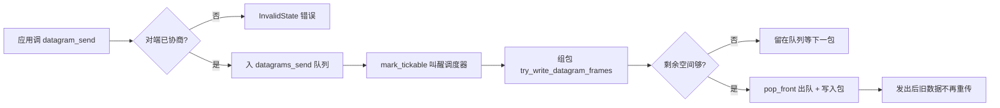
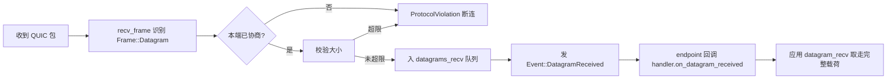

# tquic DATAGRAM（不可靠传输）扩展实现详解

> 对应 `spike/datagram/` 对 tquic 1.6.0 的 fork 改动。
> 目标读者：想理解「给 QUIC 栈加不可靠传输」是怎么动手的人。
> 配套结论文档见 [README.md](./tquic-vauid/README.md)。

---

## 0. 为什么需要这场改动

QUIC 的常规流（STREAM 帧）是**可靠、有序**的：丢了会重传，保证数据完整到达。
这对文件、消息没问题，但对**音视频**是灾难——几个连续的旧帧重传回来，画面早就延误了，
重传等于浪费带宽、加大延迟。

RFC 9221 定义了 QUIC 的 **DATAGRAM 帧**：上层主动说「这一帧丢了就丢了，别重传」。
它是「尽力而为」传输，适合音视频这种时效性 > 完整性 的数据。

**问题**：tquic 1.6.0 没有实现 DATAGRAM。所以我们要动手给它加上。

---

## 1. RFC 9221 核心概念复习（先懂协议，再看代码）

| 概念 | 说明 |
| :--- | :--- |
| 帧类型 | `0x30` = DATAGRAM（带长度前缀）；`0x31` = 不带长度（必须独占一个包）。spike 只实现 `0x30` |
| 传输参数 | `max_datagram_frame_size`（参数 ID `0x28`）**协商数据报上限**。值为 0/缺省表示**不支持** |
| 不重传 | 发送端发出后从队列移除，丢包不重发 |
| 不受流控 | 不消耗 stream 流控额度；但**计入拥塞窗口**（否则会撑爆网络） |
| 完整投递 | 接收端拿到的是一整块 data，不会半帧 |
| 仅 0-RTT/1-RTT | 握手阶段（Initial/Handshake）**不能**发 DATAGRAM |

一个关键点值得先记住：

> DATAGRAM **会被 ACK**（包级别），但**数据不会重传**。
> 也就是说——发送者知道「这个包丢了」，但选择不再发送旧数据。

---

## 2. 改动文件总览

| 文件 | 改动内容 | 角色 |
| :--- | :--- | :--- |
| `src/frame.rs` | `Frame::Datagram` 变体 + 编解码 | 帧定义层 |
| `src/trans_param.rs` | `max_datagram_frame_size` 收发与校验 | 传输参数协商 |
| `src/lib.rs` | Config setter + `TransportHandler::on_datagram_received` + `Event::DatagramReceived` | 对外 API 与回调 |
| `src/connection/connection.rs` | 收发队列、`datagram_send/recv`、写包/收包路径 | 核心往返路径 |
| `src/endpoint.rs` | 把 `DatagramReceived` 事件派发给 handler | 事件分发 |

下面逐个深入。

---

## 3. 帧定义层：`frame.rs`

### 3.1 枚举变体

```rust
/// DATAGRAM frame (type=0x30) is used to transmit unreliable datagram
Datagram { data: Bytes },
```

`data` 是完整的一块载荷，这与 STREAM 的「流式切片」截然不同——DATAGRAM 不许分片重组，
**一块就是一个完整单位**。

### 3.2 解码（读入）：读取 `0x30`

```rust
0x30 => {
    let length = b.read_varint()? as usize;      // 先读载荷长度
    if length > b.len() {
        return Err(Error::BufferTooShort);       // 长度越界 = 包损坏
    }
    // 直接从缓冲区按长度 slice 出 payload，避免拷贝
    let start = buf.len() - b.len();
    let data = buf.slice(start..(start + length));
    b.skip(length)?;
    Frame::Datagram { data }
}
```

注意这里用 `buf.slice(...)` 直接切出 `Bytes`，**零拷贝**。帧解码不复制数据，只是切视图。

### 3.3 编码（写出）

```rust
Frame::Datagram { data } => {
    b.write_varint(0x30)?;             // 帧类型
    b.write_varint(data.len() as u64)?; // 长度前缀（0x30 版本必须带长度）
    b.write(data.as_ref())?;            // 载荷
}
```

`frame.wire_len()` 也按「1 + varint(长度) + 载荷」计算，用于**判断包剩余空间能否放下**。

---

## 4. 协商层：`trans_param.rs`

DATAGRAM 能不能用，取决于**对端是否也支持**。这一步通过 QUIC 握手的传输参数完成。

结构体里加一个字段：

```rust
pub max_datagram_frame_size: Option<u64>,
```

- **解析对端参数**：`0x28` → 读入 `max_datagram_frame_size = Some(val.read_varint()?)`
- **打包本端参数**：`max_datagram_frame_size > 0` 时才写出该参数（`Some(0)` 表示「我不支持」，不写）

这就构成了能力协商：**我告诉你我最多能吃多大 datagram，你也告诉我你的。**
发送时只能发「你承诺的最大值」以内的帧。

---

## 5. 对外 API 层：`lib.rs`

### 5.1 Config setter —— 让使用者开启能力

```rust
pub fn set_max_datagram_frame_size(&mut self, v: u64) {
    self.local_transport_params.max_datagram_frame_size = if v > 0 {
        Some(v)
    } else {
        None // 关闭：对端将看不到本端支持 DATAGRAM
    };
}
```

双端都必须 `set_max_datagram_frame_size(>=0 非零)`，否则协商失败，发送时收到错误。

### 5.2 事件枚举 + handler 回调 —— 通知应用「有数据报到了」

```rust
// Event 枚举新增：
DatagramReceived,                            // lib.rs ~947

// TransportHandler trait 新增默认实现（不破坏已有 handler）：
/// Use `Connection::datagram_recv()` to drain the received datagrams.
fn on_datagram_received(&mut self, conn: &mut Connection) {}
```

`on_datagram_received` 默认是空实现——**老代码不实现它也能编译运行**。
应用想收 datagram 时，在回调里调 `conn.datagram_recv()` 逐个取。

---

## 6. 核心路径：`connection.rs`

这是改动的重头，分「数据结构 / 发送 API / 收包 / 写包 / 接收分发」五块。

### 6.1 数据结构 —— 一个连接两个队列

```rust
datagrams_send: VecDeque<Bytes>,   // 待发送的 datagram（先进先出）
datagrams_recv: VecDeque<Bytes>,   // 收到的 datagram，等应用来取
```

用「队列」而非「单槽」是关键：**发送和接收都可能积压多帧**，
VecDeque 保证先进先出、乱序交付由上层根据 seq 去重（对应我们 Message 帧里的 `seq` 字段）。

### 6.2 发送 API：`datagram_send`

```rust
pub fn datagram_send(&mut self, buf: Bytes) -> Result<()> {
    self.mark_tickable(true);            // ① 告诉事件循环「需要我发包」

    // ② 对端必须已协商 DATAGRAM
    let peer_max = self.peer_transport_params.max_datagram_frame_size.unwrap_or(0);
    if peer_max == 0 {
        return Err(Error::InvalidState("DATAGRAM extension was not negotiated"));
    }

    // ③ 帧的整体长度不能超过对端承诺
    let wire_len = 1 + codec::encode_varint_len(buf.len() as u64) + buf.len();
    if wire_len as u64 > peer_max {
        return Err(Error::InvalidState("DATAGRAM frame exceeds the peer's max..."));
    }

    self.datagrams_send.push_back(buf);  // ④ 入队，等组包时发出
    Ok(())
}
```

**`mark_tickable(true)` 是易被忽略但极其重要的一步**：
tquic 的事件循环只在「有工作可做」时驱动连接发包。手动塞进一个新 datagram 后，
如果不标记 tickable，事件循环可能就此停住，数据永远发不出去。这行代码就是「叫醒调度器」。

### 6.3 写包路径：`try_write_datagram_frames`

在「把包填满」的阶段被调用，把队列里的 datagram 塞进 QUIC 包：

```rust
fn try_write_datagram_frames(&mut self, out, st, pkt_type, path_id) -> Result<()> {
    // ① 只在 0-RTT/1-RTT 包发（RFC 9221 §3：握手包不能带 datagram）
    if (pkt_type != OneRTT && pkt_type != ZeroRTT)
        || self.is_closing()
        || self.datagrams_send.is_empty()
        || !self.paths.get(path_id)?.active()
    {
        return Ok(());
    }

    while let Some(data) = self.datagrams_send.front().cloned() {
        let frame = Frame::Datagram { data };
        if st.written + frame.wire_len() > out.len() {
            break;              // ② 当前包放不下 → 留在队列，等下一个包
        }
        self.datagrams_send.pop_front();   // ③ 一旦写入 → 出队，造成「丢包不重传」
        Connection::write_frame_to_packet(frame, out, st)?;
        st.ack_eliciting = true;           // 这个包需要 ACK
        st.in_flight = true;
        st.has_data = true;
    }
    Ok(())
}
```

这里藏着「可靠 vs 不可靠」的分水岭：

> `pop_front()` 在写入后立刻执行。datagram 从发送队列消失。
> 之后这个包如果丢了，只会触发 ACK 缺失（拥塞控制感知丢包），
> **旧数据不会再被重新入队发送**——这就是「不重传」的代码落点。

`ack_eliciting = true` 让该包参与拥塞窗口计算（丢包时会降窗口），
保证 DATAGRAM 不会因「不受流控」就无限灌爆网络。

### 6.4 IN/OUT 交给 `write_frame_to_packet`

`write_frame_to_packet` 已经知道如何处理任意 `Frame`：它先用 `wire_len()` 检查空间，
再调用编码把帧写进包缓冲。DATAGRAM 无须特殊逻辑——新增帧类型天然接入这条通用流水线。

> 包级行为的小差异：如果 DATAGRAM 是包里唯一的、发完就 `fin` 的帧，
> 需要确保它就是本包的最后一个帧（tquic 现有逻辑 `Finish()::fin()` 处理包收尾）。

### 6.5 接收分发：`recv_frame` 里的 `Frame::Datagram`

收到对端 DATAGRAM 时：

```rust
Frame::Datagram { data } => {
    // ① 安全检查：本端自己必须也支持 DATAGRAM
    let local_max = self.local_transport_params.max_datagram_frame_size.unwrap_or(0);
    if local_max == 0 {
        return Err(Error::ProtocolViolation);   // 我"不支持"却收到 → 协议违规
    }
    // ② 超出承诺大小 → 也是协议违规
    if 1 + codec::encode_varint_len(data.len()) + data.len() > local_max as usize {
        return Err(Error::ProtocolViolation);
    }
    // ③ 入队 + 发事件，等应用刷新
    self.datagrams_recv.push_back(data);
    self.events.add(Event::DatagramReceived);
}
```

端口有严格的双向校验：**我不支持 → 收到帧是协议违规**（对端不该发），**超大小 → 也违规**。
这两道校验正是 RFC「协商是承诺，超承诺即错误」的落地。

### 6.6 消费 API：`datagram_recv`

```rust
pub fn datagram_recv(&mut self) -> Result<Option<Bytes>> {
    self.mark_tickable(true);
    Ok(self.datagrams_recv.pop_front())
}
```

返回 `Option<Bytes>`：`None` 表示队列空。配套还有 `datagram_send_queue_len()` /
`datagram_recv_queue_len()` 供上层观察积压，避免无限增长。

---

## 7. 数据流全景

### 发送方向



### 接收方向



---

## 8. 三个「为什么」——读懂实现意图

### 8.1 为什么只能在 0-RTT / 1-RTT 包发？

握手还没完成前没有会话密钥，STREAM 语义都没建立，更遑论通信双方想约定 datagram 参数。
RFC 9221 §3 明确禁止握手包携带 DATAGRAM，代码里 `pkt_type != OneRTT && != ZeroRTT` 直接拦截。

### 8.2 为什么入队后要 `mark_tickable(true)`？

tquic 是**事件驱动**的：`run()` 会 `process_connections()` 驱动各连接。
如果应用在两次驱动之间塞入数据却不标记，事件循环可能认为「没有待办」而阻塞在 socket 读取，
新数据被滞留。`mark_tickable(true)` 等价于「我有自己的工作要做，来驱动我一次」。

### 8.3 为什么「有 ACK，却不重传」？

- **是包**：DATAGRAM 在一个带 ACK 的包内发送，所以包的存在会被 ACK，丢包会让拥塞窗口收缩。
- **不是流**：数据在写入瞬间已从 `datagrams_send` 出队。拥塞控制只知道「丢了一个包」，
  不知道该包原来的内容——因为内容已经被丢弃了。

这个设计让 DATAGRAM **既感知网络拥堵（降速），又不像 STREAM 那样为旧帧执着（重传）**。
对音视频是理想特性：网络不好就丢帧降质量，而不是越堵越重传。

---

## 9. 已实现 vs 局限

| 项 | 状态 |
| :--- | :--- |
| `0x30`（带长度）帧编解码 | ✅ 实现 |
| `0x31`（不带长度）帧 | ❌ 未实现（RFC 可选，独占包，spike 未见需求） |
| 协商：`max_datagram_frame_size` | ✅ 实现 + 双向校验 |
| 发送/接收公共 API | ✅ `datagram_send/recv` + 队列长度查询 |
| 应用回调 | ✅ `on_datagram_received`（默认空实现） |
| 发送/接收队列大小上限 | ⚠️ TODO 注释，未加硬限制（积压可能无限增长） |
| 弱网验证（丢包不重传/乱序） | ⚠️ 协议语义推论，需 Phase 1 `tc netem` 实测 |
| 拥塞控制交互调优 | ⚠️ 已计入 cwnd，但 BBR 下专项调参留待 Phase 1 |
| 1200B 以上依赖 DPLPMTUD | ✅ 走既有 `max_datagram_size` 探测 |

---

## 10. 写回主线（Phase 1 Task 1.4）的落地建议

1. **独立 git 仓库**：把这份 tquic 设为独立 fork，`git remote add upstream` 挂上游，
   改动拆成独立 commit，方便日后 rebase 跟进上游安全/性能修复。
2. **`[patch.crates-io]` 引入主工作区**：`Cargo.toml` 里 `tquic = { git = "…", branch = "…" }`，
   不必把 fork 塞进主仓库。
3. **feature 门控**：`vauid/datagram` 特性默认关闭，不影响现有 Stream 回显/转发路径；
   打开后才暴露 `datagram_send/recv`。
4. **落地顺序**：帧编解码单测 → 双端协商测试 → 收发 API → 弱网吞吐/乱序实测。

---

*本改动是「最小侵入补丁」：没有触碰拥塞控制、恢复、流控等核心，
仅在帧层 / 参数层 / 连接队列层加挂不可靠通道。这也是它能跑通往返、又能干净写回主线的根本原因。*